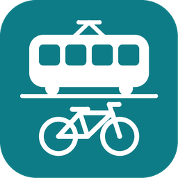

# Zaragoza Open Data

**English: [README.md](README.md)**

Los datos públicos de Zaragoza en Home Assistant: llegadas de tranvía y autobús a cualquier
parada, bicis y anclajes de Bizi, obras y cortes, farmacias de guardia, calidad del aire y
polen. Se configura desde la interfaz eligiendo en listas. No hace falta cuenta ni clave.

> **No oficial.** Esta integración no está vinculada al Ayuntamiento de Zaragoza ni a los
> operadores del tranvía, el autobús o Bizi, y ninguno de ellos la patrocina ni la respalda.

- [Qué incluye](#qué-incluye)
- [Instalación](#instalación)
- [Configuración y paradas](#configuración-y-paradas)
- [Opciones](#opciones)
- [Cómo se actualizan los datos](#cómo-se-actualizan-los-datos)
- [La tarjeta de búsqueda](#la-tarjeta-de-búsqueda)
- [Acciones](#acciones)
- [Ejemplos](#ejemplos)
- [El mapa «Zaragoza»](#el-mapa-zaragoza)
- [Índice de calidad del aire](#índice-de-calidad-del-aire)
- [Preguntar a Assist: el plano](#preguntar-a-assist-el-plano)
- [Solución de problemas](#solución-de-problemas)
- [Limitaciones conocidas](#limitaciones-conocidas)
- [Desinstalación](#desinstalación)
- [Datos y atribución](#datos-y-atribución)
- [Iconos](#iconos)

## Qué incluye

Cada tipo de datos se puede desactivar. Las paradas y estaciones se añaden de una en una, y
cada una es un dispositivo.

| Datos | Entidades |
| --- | --- |
| Parada de tranvía (un andén) | **Próxima llegada** y **Siguiente llegada** (sensores de hora, con línea y destino). **Minutos para la próxima**: minutos enteros hasta la próxima, tal como los cuenta la fuente, con `following` (la siguiente) y `arrivals`. |
| Parada de autobús | Lo mismo, de todas las líneas de la parada o de las que elijas, y qué fuente ha respondido: el operador o el Ayuntamiento. |
| Estación Bizi | **Bicis**, **Bicis eléctricas**, **Bicis mecánicas**, **Anclajes libres**; **Presta bicis** y **Admite devoluciones** (sí/no); **Último informe**. |
| Avisos del tranvía | Un sensor en el dispositivo principal: cuántos avisos ha publicado el tranvía y qué dicen. |
| Obras y cortes | Una capa de mapa con un marcador por cada una cercana, y un recuento **Cercanas**. Un evento por cada obra nueva. |
| Farmacias de guardia | Una capa de mapa con las farmacias de hoy, y un sensor **Más cercana** con dirección, teléfono, horario, la fecha de la guardia y hasta cuándo está abierta. |
| Calidad del aire | Un sensor por cada contaminante que mide la estación elegida, un sensor **Índice** y una capa de mapa con las 8 estaciones, todos con la hora a la que el Ayuntamiento publicó la lectura. |
| Polen | Un sensor por planta, con su nivel y la fecha de publicación. |

El sensor de próxima llegada también lista todas las llegadas previstas y lleva las coordenadas
de la parada, para ponerla en un mapa. Cuando no viene nada (en una parada de tranvía de noche,
por ejemplo), los sensores de llegada quedan en `unknown` (desconocido). No es un error y no se
registra nada.

**Cómo llegar:** el marcador de una farmacia, el sensor **Más cercana** y cada parada de
tranvía o autobús y estación Bizi llevan un atributo `directions`: un enlace de Google Maps con la
ruta hasta allí. Home Assistant solo muestra los atributos en ⋮ → **Atributos** del diálogo de la
entidad, así que el enlace sirve sobre todo para automatizaciones y scripts, por ejemplo una
notificación en el móvil con un botón "Cómo llegar".

Además, tres [acciones](#acciones) responden por cualquier parada, esté añadida o no. Las usan
la [tarjeta de búsqueda](#la-tarjeta-de-búsqueda) y el [plano](#preguntar-a-assist-el-plano).

## Instalación

Necesitas Home Assistant 2026.11 o posterior. La integración se instala desde el **Marketplace**
de Home Assistant, como repositorio personalizado.

1. Ve a **Configuración → Marketplace**. La primera vez muestra un aviso sobre el contenido de la
   comunidad: léelo, marca **Entiendo los riesgos y estoy de acuerdo** y pulsa **Continuar**.
2. Pulsa **Añadir desde enlace**, escribe `https://github.com/nachogarcia/ha-zaragoza-open-data`
   como **Enlace de GitHub** y pulsa **Añadir**. Si te pide el **Tipo**, elige **Integración**.
   Añadir desde un enlace necesita una conexión con GitHub: si no la hay, el Marketplace te pide
   antes que conectes GitHub. O usa este botón:

   [](https://my.home-assistant.io/redirect/marketplace_repository/?owner=nachogarcia&repository=ha-zaragoza-open-data&category=integration)
3. Abre **Zaragoza Open Data** en el Marketplace y pulsa **Instalar**.
4. Reinicia Home Assistant.

## Configuración y paradas

1. Ve a **Configuración → Dispositivos y servicios → Añadir integración** y busca
   **Zaragoza Open Data**, o usa este botón:

   [](https://my.home-assistant.io/redirect/config_flow_start/?domain=zaragoza_open_data)
2. Marca los datos que quieras (al principio está todo marcado) y envía. Antes de crear nada,
   comprueba que responden las fuentes de lo que has marcado.

Las distancias se miden desde la casa de Home Assistant (**Configuración → Información sobre el hogar**).

Para añadir una parada, abre la página de la integración y elige **Añadir parada de tranvía**,
**Añadir parada de autobús** o **Añadir estación Bizi**:

- La lista tiene todas las paradas, las más cercanas a casa primero, con su distancia.
- Escribe para filtrarla por parte del nombre, el número, la calle o una línea. Dan igual las
  tildes y las mayúsculas. También puedes escribir el número de una parada de autobús, que
  está en su poste.
- **Cerca de otro lugar…**, arriba del todo, te deja poner una chincheta en el mapa y ordena la
  lista desde ahí (para una parada cerca del trabajo).
- Una parada de tranvía tiene dos andenes, uno por sentido, que aparecen como
  «Plaza Espana → Avenida de la Academia». Añade el andén que usas.
- En una parada de autobús marcas después las líneas que quieres ver; sin ninguna marcada se
  ven todas. Para cambiarlas más tarde, elige **Cambiar líneas** en la entrada de la parada.

Para quitar una parada, elige **⋮ → Eliminar** en su entrada. Se van con ella su dispositivo y
sus entidades. Si una parada lleva más de un día sin aparecer en la lista de su fuente (porque
ha cambiado de número o la han retirado), una reparación te ofrece quitarla.

## Opciones

Ve a **Configuración → Dispositivos y servicios → Zaragoza Open Data → Configurar**.

| Opción | Qué hace | Por defecto |
| --- | --- | --- |
| Datos | Qué tipos están activados. Al desactivar uno se quitan sus entidades y dispositivos y deja de consultarse. Un tipo de transporte que aún tiene paradas no se puede desactivar: quita antes sus paradas. | Todos |
| Obras: distancia | Hasta qué distancia del centro se muestran las obras, en km. 0 muestra toda la ciudad. | 2 km |
| Obras: medida desde | Casa u otra zona, como Trabajo. Si esa zona se borra, se usa casa. | Casa |
| Obras: categorías | Corte de tráfico, corte de agua, afección importante, afección al transporte público, conservación, otra. | Todas |
| Farmacias de guardia: distancia | Como en las obras. | 0 (toda la ciudad) |
| Farmacias de guardia: medida desde | Como en las obras. | Casa |
| Estación de calidad del aire | Qué estación usan los sensores. | La más cercana a casa |
| Avanzado: intervalos de actualización | Cada cuánto se consulta cada fuente (ver abajo). Cada valor por defecto es también el mínimo: los intervalos solo se pueden alargar. | |

## Cómo se actualizan los datos

| Fuente | Actualización (por defecto y mínimo) | Máximo |
| --- | --- | --- |
| Tranvía | 60 s, unos 10 s después de cada minuto en punto, justo después de que publique el Ayuntamiento. Se redondea hacia arriba a minutos enteros. | 1 día |
| Autobús | 60 s | 1 día |
| Bizi | 120 s | 1 día |
| Obras | 30 min | 1 día |
| Calidad del aire | 30 min | 1 día |
| Polen | 6 h | 7 días |
| Farmacias de guardia | 6 h, y cada día a las 09:20, justo después del cambio de guardia de las 09:15 | 7 días |

- **Tranvía:** una sola descarga sirve para todos los andenes.
- **Autobús:** se consulta primero la página de llegadas del operador, y el servicio del
  Ayuntamiento es la alternativa. Si falla el operador, responde el Ayuntamiento durante 5
  minutos antes de volver a probar con el operador. Las paradas se consultan de una en una, con
  una pausa entre ellas. Si no responde ninguno, se siguen mostrando las últimas llegadas de la
  parada hasta 10 minutos, sin los autobuses que ya han pasado.
- **Bizi:** primero el servicio del operador y, como alternativa, la lista del Ayuntamiento. La
  lista del Ayuntamiento solo incluye algunas estaciones, así que las demás quedan no
  disponibles mientras la sustituye.
- **Un fallo breve de una fuente** mantiene sus últimos valores. **Si la caída se alarga,** sus
  entidades quedan no disponibles y los demás tipos siguen funcionando; el registro anota una
  línea cuando deja de responder y otra cuando vuelve.

## La tarjeta de búsqueda

Para cualquier parada, sobre la marcha y sin añadirla. Elige Tranvía, Bus o Bizi, y después
desde dónde buscar: **Mi ubicación**, **Casa**, una **Zona** o **Escribir parada…** (con
sugerencias mientras escribes). Toca una parada para ver sus próximas llegadas, o las bicis y
anclajes libres de una estación Bizi.

- La tarjeta viene con la integración y se registra sola, así que no hace falta añadir un
  recurso al panel. Añadirlo de todos modos no hace daño.
- Añádela desde el editor del panel con **Añadir tarjeta → Zaragoza Open Data**. Sus ajustes
  están en el editor visual.
- Se actualiza una vez por minuto, justo después de que bajen los minutos, así que muestra el
  mismo número que el sensor **Minutos para la próxima** de la parada; y solo mientras está en
  pantalla. Tras un error se para, muestra el mensaje con un botón **Reintentar** y vuelve a
  probar la próxima vez que se vea.
- Cada móvil o navegador recuerda su última parada, así que cada persona ve la suya.
- Sigue el idioma de Home Assistant, español o inglés.

```yaml
type: custom:zaragoza-open-data-card
modes: [tram, bus, bizi]
default_mode: tram
nearest: 5
home_zone: zone.home
show_zones: true
```

| Ajuste | Qué hace | Por defecto |
| --- | --- | --- |
| `modes` | Cuáles de `tram`, `bus` y `bizi` ofrecer, en ese orden. | Los tres |
| `default_mode` | El modo que se muestra primero. | El primero de `modes` |
| `nearest` | Cuántas paradas cercanas listar, de 1 a 10. | 5 |
| `home_zone` | La zona que se usa para **Casa**. | `zone.home` |
| `show_zones` | Si se ofrece **Zona**. | `true` |
| `my_location_entity` | La persona cuya ubicación usa **Mi ubicación**. | Quien mira |

## Acciones

Las tres acciones responden con datos, para cualquier parada o estación, esté añadida o no.
Pruébalas en **Configuración → Herramientas → Acciones**. Funcionan mientras la
integración está cargada y el tipo está activado.

### `zaragoza_open_data.find_stops`

Busca paradas de tranvía, de autobús o estaciones Bizi. Primero va el número exacto, después
las paradas cuyo nombre o número contiene todas las palabras, y después las que solo coinciden
por sentido, línea o calle. Dentro de cada grupo, las más cercanas primero.

| Campo | Obligatorio | Descripción |
| --- | --- | --- |
| `kind` | sí | `tram`, `bus` o `bizi` |
| `query` | no | Parte de un nombre, un número, una calle o una línea. Dan igual las tildes y las mayúsculas. Sin texto, devuelve las más cercanas. |
| `latitude`, `longitude` | no | Desde dónde medir: los dos o ninguno. Sin ellos, desde casa. |
| `limit` | no | Cuántas devolver, de 1 a 50. 8 por defecto. |

```yaml
action: zaragoza_open_data.find_stops
data:
  kind: tram
  query: pilar
  limit: 2
```

```yaml
stops:
  - code: "1101"
    name: Plaza del Pilar - Murallas
    direction: Mago de Oz
    lines: [L1]
    distance_m: 1104
    latitude: 41.65727632462157
    longitude: -0.8821748834915281
  - code: "1102"
    name: Plaza del Pilar - Murallas
    direction: Avenida de la Academia
    lines: [L1]
    distance_m: 1104
    latitude: 41.657231175221874
    longitude: -0.8820733181164175
```

`direction` (sentido) es `null` salvo en los andenes de tranvía; un andén donde los tranvías solo
llegan tampoco lo tiene. Las estaciones Bizi tienen `lines: []`.

### `zaragoza_open_data.get_arrivals`

Los próximos tranvías o autobuses de una parada.

| Campo | Obligatorio | Descripción |
| --- | --- | --- |
| `mode` | sí | `tram` o `bus` |
| `stop` | sí | El `code` de la parada que da `find_stops`; en una parada de autobús, el número de su poste. |

```yaml
action: zaragoza_open_data.get_arrivals
data:
  mode: tram
  stop: "1302"
```

```yaml
stop:
  code: "1302"
  name: Plaza Espana
  direction: Avenida de la Academia
arrivals:
  - line: L1
    destination: Avenida Academia
    minutes: 1
    time: "2026-11-09T13:41:02+01:00"
  - line: L1
    destination: Avenida Academia
    minutes: 6
    time: "2026-11-09T13:46:02+01:00"
source: zaragoza_city
updated: "2026-11-09T13:40:02+01:00"
```

- `minutes` es la cuenta de la fuente a la hora de `updated`, menos cada minuto entero desde
  entonces: el mismo número que muestra el sensor **Minutos para la próxima** de la parada.
  `time` y `updated` van en la zona horaria de Home Assistant.
- `source` es `zaragoza_city`, o `avanza` (el operador) en un autobús.
- La respuesta del tranvía sale de la misma descarga que usan los sensores. Una parada de
  autobús se consulta al llamar, y se reutiliza una respuesta de menos de 30 s.

### `zaragoza_open_data.get_bizi_station`

Las bicis y anclajes libres de una estación Bizi.

| Campo | Obligatorio | Descripción |
| --- | --- | --- |
| `station` | sí | El número de la estación, como al principio de su nombre. |

```yaml
action: zaragoza_open_data.get_bizi_station
data:
  station: "16"
```

```yaml
station:
  code: "16"
  name: "Pza. España"
bikes: 21
electric: 21
mechanical: 0
docks: 10
renting: true
returning: true
source: gbfs
updated: "2026-11-09T13:39:15+01:00"
```

`electric` y `mechanical` son `null` mientras la lista del Ayuntamiento sustituye a la del
operador, porque no las distingue.

### Errores

Una parada desconocida, o un tipo desactivado, se rechaza con un mensaje que lo dice. Igual con
una fuente que no responde, y con una estación Bizi de la que la fuente que responde no da bicis
ni anclajes (en mantenimiento, o fuera de la lista del Ayuntamiento mientras la sustituye). En un
script, añade `continue_on_error: true` al paso para seguir después de un error.

## Ejemplos

### Insignia: minutos para los próximos tranvías

Una insignia del panel con los minutos para el próximo tranvía y para el siguiente, por ejemplo
«1 min · 6». En el editor del panel elige **Añadir insignia** y edítala en modo YAML. Una
tarjeta de mosaico admite el mismo `state_content`.

```yaml
type: entity
entity: sensor.plaza_espana_avenida_de_la_academia_minutos_para_la_proxima
state_content:
  - state
  - following
```

El número es el que da el Ayuntamiento o el operador, y `0` significa que el tranvía o el
autobús está en la parada. Cuando no viene nada, la insignia muestra `unknown` (desconocido).
`arrivals` lista cada llegada con su línea, destino, minutos y hora, para una tarjeta propia.

### Script: los próximos tranvías en mi móvil

Cambia `notify.mobile_app_mi_movil` por la acción de notificación de tu móvil.

```yaml
alias: Próximos tranvías en mi móvil
sequence:
  - action: zaragoza_open_data.get_arrivals
    data:
      mode: tram
      stop: "1302"
    response_variable: board
  - action: notify.mobile_app_mi_movil
    data:
      title: "{{ board.stop.name }} → {{ board.stop.direction }}"
      message: >-
        {{ arrival.line }} a
        {{ arrival.destination }}: {{ arrival.minutes }} min. Ahora no
        viene nada.
```

### Automatización: un corte de tráfico nuevo a menos de 500 m de casa

La integración lanza el evento `zaragoza_open_data_new_road_work` por cada obra de su capa de
mapa que no ha visto en los últimos 30 días. Sus datos:

- `id`, `title` (título), `street` (calle), `category` (categoría)
- `distance_km`, desde el centro de la capa (casa, salvo que lo cambies en las opciones)
- `latitude`, `longitude`, `starts` (desde), `ends` (hasta)

Solo se anuncian las obras dentro de la distancia y las categorías de la capa. En el primer
arranque no se anuncia nada, porque todas las obras son nuevas.

Usa este evento y no el disparador de geolocalización de Home Assistant: ese vuelve a disparar
«entrar» con obras que ya estaban, tras cada reinicio o corte breve.

```yaml
alias: Corte de tráfico nuevo cerca de casa
triggers:
  - trigger: event
    event_type: zaragoza_open_data_new_road_work
conditions:
  - condition: template
    value_template: >-
      {{ trigger.event.data.category == 'traffic_closure'
         and trigger.event.data.distance_km <= 0.5 }}
actions:
  - action: notify.notify
    data:
      title: "Calle cortada: {{ trigger.event.data.street }}"
      message: >-
        {{ trigger.event.data.title }}, a {{ trigger.event.data.distance_km }} km.
        Hasta el
        {{ as_datetime(trigger.event.data.ends).strftime('%d/%m') }}.
```

### Automatización: el próximo tranvía al salir de casa

Cambia la persona, el móvil y el sensor por los tuyos (ver [ID de entidad](#el-mapa-zaragoza)).

```yaml
alias: Próximo tranvía al salir de casa
triggers:
  - trigger: zone
    entity_id: person.ana
    zone: zone.home
    event: leave
actions:
  - action: notify.mobile_app_movil_de_ana
    data:
      message: >-
        
        Ahora no viene ningún tranvía.El
        próximo tranvía pasa en {{ ((as_datetime(next) - now()).total_seconds() // 60) | int }}
        min.
```

## El mapa «Zaragoza»

Tu panel **Mapa** automático muestra todas las entidades que tienen una posición, y eso incluye
las de esta integración: las obras, las farmacias de guardia y las estaciones de calidad del
aire, y los sensores que llevan las coordenadas de su parada o estación (la **Próxima llegada**
de cada parada, las **Bicis** de cada estación Bizi y los sensores de calidad del aire). Para que
ese panel muestre solo a las personas, mira [más abajo](#el-panel-mapa-solo-con-personas).

La integración no puede crear paneles. Para ver sus marcadores con su leyenda, añade esta
tarjeta a un panel (por ejemplo, uno nuevo llamado «Zaragoza»), en el modo YAML del editor de
tarjetas:

```yaml
type: vertical-stack
cards:
  - type: map
    title: Zaragoza
    geo_location_sources:
      - zaragoza_open_data_road_works
      - zaragoza_open_data_pharmacies
      - zaragoza_open_data_air_quality
    entities:
      - sensor.plaza_espana_avenida_de_la_academia_proxima_llegada
      - sensor.688_p_reyes_de_aragon_n_o_24_linea_58_proxima_llegada
      - entity: sensor.16_pza_espana_bicis
        label_mode: state
  - type: markdown
    content: |
      | | | | |
      |---|---|---|---|
      |  | Calle cortada |  | Obras |
      |  | Afección importante |  | Afección al transporte público |
      |  | Corte de agua |  | Otra obra |
      |  | Farmacia de guardia |   | Parada de tranvía, de autobús |
      | **12** | Bizi: bicis disponibles | | |

      Calidad del aire:
       buena
       razonablemente buena
       regular
       desfavorable
       muy desfavorable
       extremadamente desfavorable
       sin datos
```

- **Tus ID de entidad** dependen de la parada y del idioma de Home Assistant: cópialos de la
  página de dispositivo de cada parada. El ejemplo tiene el andén Plaza Espana → Avenida de la
  Academia, la parada de autobús 688 y la estación Bizi 16, añadidos en español.
- **Las estaciones Bizi** no tienen imagen: con `label_mode: state`, el marcador muestra el
  número de bicis.
- Los marcadores cercanos se agrupan en un número. Toca uno para ver sus detalles: la calle, el
  motivo, el tramo, el desvío y las fechas de una obra; la dirección, el teléfono, el horario y
  la fecha de guardia y hasta cuándo abre una farmacia; el índice, las lecturas y su hora de
  publicación de una estación.
- **Tras una actualización que cambie un marcador**, el mapa muestra el nuevo enseguida, pero un
  móvil o navegador que ya mostró la leyenda puede seguir con sus imágenes antiguas, que guarda
  hasta un mes, hasta que se borre su caché.

Los marcadores, que sirve la integración desde `/zaragoza_open_data/markers/`:

| Marcador | Significado |
| --- | --- |
|  | Calle cortada al tráfico |
|  | Obras y conservación |
|  | Afección importante |
|  | Afección al transporte público |
|  | Corte de agua |
|  | Otra obra, o una categoría que el Ayuntamiento añada más adelante |
|  | Farmacia de guardia: la cruz verde de las farmacias |
|   | Tus paradas de tranvía y autobús |
|  …  | Estación de calidad del aire: cuatro puntos, por las partículas, en el color de su [índice](#índice-de-calidad-del-aire); gris sin datos |

### El panel Mapa solo con personas

Dale al panel **Mapa** su propia tarjeta de mapa con las personas y las zonas, y deja las capas
de la ciudad en la tarjeta «Zaragoza». Abre el panel, elige
**Editar panel de control → Tomar el control** y sustituye su tarjeta de mapa, en el modo YAML
del editor de tarjetas, por una como esta (con tus personas y zonas en lugar de estas):

```yaml
type: map
auto_fit: true
entities:
  - person.ana
  - zone.home
```

A partir de entonces, el panel ya no añade personas por su cuenta: añade las nuevas a la lista.

## Índice de calidad del aire

El sensor **Índice** y los marcadores de las estaciones usan el **Índice Europeo de Calidad del
Aire** de la Agencia Europea de Medio Ambiente (AEMA, en inglés EEA), en la versión vigente desde
el 4 de julio de 2025 ([EEA](https://airindex.eea.europa.eu/AQI/index.html); informe ETC HE
2024/17, tabla 5.2).

| Banda | Color | PM2,5 | PM10 | NO₂ | O₃ | SO₂ |
| --- | --- | --- | --- | --- | --- | --- |
|  Buena | `#50F0E6` | ≤ 5 | ≤ 15 | ≤ 10 | ≤ 60 | ≤ 20 |
|  Razonablemente buena | `#50CCAA` | ≤ 15 | ≤ 45 | ≤ 25 | ≤ 100 | ≤ 40 |
|  Regular | `#F0E641` | ≤ 50 | ≤ 120 | ≤ 60 | ≤ 120 | ≤ 125 |
|  Desfavorable | `#FF5050` | ≤ 90 | ≤ 195 | ≤ 100 | ≤ 160 | ≤ 190 |
|  Muy desfavorable | `#960032` | ≤ 140 | ≤ 270 | ≤ 150 | ≤ 180 | ≤ 275 |
|  Extremadamente desfavorable | `#7D2181` | > 140 | > 270 | > 150 | > 180 | > 275 |

- Los valores son lecturas horarias en µg/m³, que es lo que publica el Ayuntamiento cada hora.
- La banda es la peor entre los contaminantes que mide la estación. Cada límite pertenece a su
  banda: 5 µg/m³ justos de PM2,5 siguen siendo «buena».
- El atributo `pollutant` dice qué contaminante ha fijado la banda. `complete` es verdadero
  cuando la estación tiene NO₂ y PM2,5 o PM10, el mínimo de la EEA para una estación de tráfico.
- Sin ninguno de estos contaminantes, el índice queda en `unknown` y el marcador, gris.
- Sigue el **índice actual de la EEA, no el ICA español**. Los nombres de las bandas son los del
  ICA, pero el ICA sigue usando los umbrales antiguos de la EEA, así que pueden no coincidir.

## Preguntar a Assist: el plano

El plano (blueprint) responde a «¿Cuándo pasa el tranvía en Plaza España?» o «When is the next
bus at 688?» por Assist, en el idioma en que preguntes, español o inglés.

[](https://my.home-assistant.io/redirect/blueprint_import/?blueprint_url=https%3A%2F%2Fgithub.com%2Fnachogarcia%2Fha-zaragoza-open-data%2Fblob%2Fmain%2Fblueprints%2Fautomation%2Fzaragoza_open_data%2Fask_next_tram.yaml)

Impórtalo y crea una automatización a partir de él. Sus frases son ajustes que puedes cambiar.
Por defecto:

- En español: «cuándo pasa el {mode} en {stop}», y variantes con «por», «llega», «viene» y
  «próximo».
- En inglés: «when is the next {mode} at {stop}», «when does the next {mode} come at {stop}» y
  «next {mode} at {stop}».

`{mode}` es tranvía, tram, autobús o bus, y `{stop}`, el nombre o el número de una parada.
Busca la parada con `find_stops`, igual que la tarjeta de búsqueda, y responde con hasta tres
llegadas de `get_arrivals`:

> Plaza Espana, hacia Mago de Oz: línea L1 a Mago de Oz en 2 minutos; línea L1 a Mago de Oz en
> 7 minutos.

Una parada de tranvía tiene un andén por sentido: el plano responde por el más cercano a casa,
sin contar un andén donde los tranvías solo llegan. La respuesta siempre nombra la parada y el
sentido que ha usado.

Si ninguna parada coincide, si no viene nada o si la fuente no responde, lo dice. Si no puede
buscar paradas, lo dice y te pide que compruebes que el tranvía o el autobús están activados en
las opciones.

## Solución de problemas

- **«No se puede contactar con el servicio de datos abiertos del Ayuntamiento» al configurar o
  al añadir una parada.** El servicio del Ayuntamiento está caído o lento. Espera unos minutos y
  vuelve a enviar.
- **Las entidades de un tipo no están disponibles.** Su fuente no responde. Vuelven solas, y el
  registro dice cuándo dejó de responder y cuándo volvió.
- **El `source` de una parada de autobús es `zaragoza_city`.** La página del operador no ha
  respondido y ha respondido el Ayuntamiento. El operador se vuelve a probar a los 5 minutos.
- **Algunas estaciones Bizi no están disponibles.** El servicio del operador está caído, y la
  lista del Ayuntamiento, que lo sustituye, no las incluye.
- **Los sensores del tranvía están en `unknown` de noche.** No viene nada; el sensor de próxima
  llegada tiene `no_service: true`.
- **Una reparación dice que una parada ya no aparece en la lista.** Lleva más de un día sin
  aparecer en la lista de su fuente. Quítala, y vuelve a añadirla si ha cambiado de número.
- **La tarjeta no sale en el selector de tarjetas.** Recarga la página en el navegador, o borra
  la caché del frontend de la app en el móvil, después de instalar o actualizar.
- **Cualquier otra cosa.** En la página de la integración, elige **⋮ → Habilitar el registro de
  depuración**, haz que vuelva a pasar y desactívalo para descargar el registro.
  **⋮ → Descargar diagnósticos** da el estado de la integración, sin las coordenadas de tu casa
  ni de los lugares que hayas elegido. Después,
  [abre una incidencia](https://github.com/nachogarcia/ha-zaragoza-open-data/issues).

## Limitaciones conocidas

- No hay ocupación del tranvía en tiempo real: el operador solo la ofrece a navegadores.
- No hay horarios, planificación de viajes, autobuses interurbanos ni historial de Bizi.
- No se pueden añadir las paradas de las líneas de autobús que el Ayuntamiento lista aparte de la
  red urbana (101, 102, 201, 501 y 601 a 605): ninguna fuente da sus llegadas.
- Las llegadas de autobús salen de la página pública de llegadas del operador, que no es una
  API documentada y puede cambiar. La alternativa del Ayuntamiento también falla a menudo.
- Los nombres y textos vienen de las fuentes, en español. La integración solo arregla las
  mayúsculas y los espacios, así que las paradas de tranvía se leen «Plaza Espana», sin eñe,
  como en la lista del Ayuntamiento.
- La tarjeta de mapa de Home Assistant no tiene leyenda ni puede colorear los marcadores por
  capa; de ahí las imágenes y la tarjeta de leyenda.
- Una sola configuración por Home Assistant.

## Desinstalación

1. Ve a **Configuración → Dispositivos y servicios → Zaragoza Open Data → ⋮ → Eliminar**. Así se
   quitan todas las paradas, dispositivos y entidades, y lo que la integración recordaba (las
   obras que ya ha visto).
2. Home Assistant te ofrece entonces desinstalarla también del Marketplace: pulsa
   **Desinstalar** y reinicia Home Assistant. Si la conservaste, abre **Zaragoza Open Data** en el
   Marketplace y elige **⋮ → Desinstalar**.
3. Borra las automatizaciones creadas con el plano, el propio plano
   (**Configuración → Automatizaciones y escenas → Planos**) y las tarjetas de tus paneles.

## Datos y atribución

| Datos | Los publica | Licencia |
| --- | --- | --- |
| Llegadas y paradas del tranvía, paradas de autobús y llegadas de autobús del Ayuntamiento, Bizi (alternativa), obras, farmacias, calidad del aire, polen | Ayuntamiento de Zaragoza, [datos abiertos](https://www.zaragoza.es/sede/portal/datos-abiertos/) | Las [condiciones de reutilización](https://www.zaragoza.es/sede/portal/aviso-legal#condiciones) del Ayuntamiento |
| Estaciones, bicis y anclajes de Bizi | El [servicio GBFS](https://zaragoza.publicbikesystem.net/customer/gbfs/v2/gbfs.json) de Bizi Zaragoza | El servicio no indica ninguna |
| Llegadas de autobús (primera opción) | La [página de llegadas](https://zaragoza-pasobus.avanzagrupo.com/frm_esquemaparadatime.php?poste=688) de Avanza Zaragoza | La página no indica ninguna |

- Las condiciones del Ayuntamiento permiten la reutilización, piden citar la fuente y proponen
  «Origen de los datos: Ayuntamiento de Zaragoza». La atribución de cada entidad nombra con esas
  palabras la fuente que ha respondido. El pie de la tarjeta nombra la fuente de lo que muestra,
  en tu idioma («Origen de los datos: Avanza Zaragoza» para un autobús del que ha respondido el
  operador).
- Los nombres, textos y horas conservan la redacción y el sentido de las fuentes: la
  integración solo arregla las mayúsculas y los espacios, y separa el número de una parada de
  su nombre.
- Las fechas de las fuentes se muestran donde las dan:
  - `published_at` en cada sensor de calidad del aire y en cada marcador de estación: cuándo
    publicó el Ayuntamiento la lectura (en el **Índice**, la lectura que ha fijado la banda)
  - `on_duty` en cada marcador de farmacia y en el sensor **Más cercana**: la fecha de la guardia
  - `open_until` (Abierta hasta) en los mismos: cuándo acaba la guardia, a las 9:15 del día
    siguiente, hora de Zaragoza
  - `published_on` en cada sensor de polen
  - el sensor **Último informe** de Bizi
  - `updated` en las respuestas de las acciones
- El Ayuntamiento de Zaragoza no participa en esta integración, ni la patrocina ni la apoya.
- Cada fuente se consulta al ritmo de
  [Cómo se actualizan los datos](#cómo-se-actualizan-los-datos), nunca en ráfagas: las paradas
  de autobús, de una en una.

## Iconos

| Iconos | Licencia | Para |
| --- | --- | --- |
| [Maki](https://github.com/mapbox/maki) | CC0 1.0 | Pictogramas de los marcadores: autobús, precaución |
| [Temaki](https://github.com/rapideditor/temaki) | CC0 1.0 | Pictogramas de los marcadores: tranvía, corte de agua |
| Señales de tráfico españolas [R-100](https://commons.wikimedia.org/wiki/File:Spain_traffic_signal_r100.svg) y [P-18](https://commons.wikimedia.org/wiki/File:Spain_traffic_signal_P-18_(2023).svg), de Wikimedia Commons | Dominio público | Marcadores de calle cortada y de obras |
| [Material Design Icons](https://github.com/Templarian/MaterialDesign) | Apache 2.0 | Iconos de las entidades |

Los marcadores son símbolos genéricos de estos conjuntos, sin logotipos de marcas ni del
Ayuntamiento. Dos son dibujos nuestros: el de farmacia, la cruz griega verde de las farmacias
españolas (nunca una roja), y el de calidad del aire, cuatro puntos de distintos tamaños que
representan partículas. El icono de la integración es un dibujo original.

## Licencia

MIT, ver [LICENSE](LICENSE).
