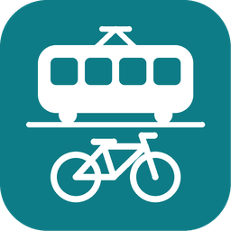

# Zaragoza Open Data

**Español: [README.es.md](README.es.md)**

Zaragoza's public data in Home Assistant: tram and bus arrivals at any stop, Bizi bikes and
docks, road works and closures, pharmacies on duty, air quality and pollen. You set it up from
the UI by picking from lists. There is no account or API key.

> **Unofficial.** This integration is not affiliated with the Ayuntamiento de Zaragoza, nor
> with the tram, bus or Bizi operators, and none of them sponsors or endorses it.

- [What you get](#what-you-get)
- [Installation](#installation)
- [Setup and adding stops](#setup-and-adding-stops)
- [Options](#options)
- [How the data is updated](#how-the-data-is-updated)
- [The search card](#the-search-card)
- [Actions](#actions)
- [Examples](#examples)
- [The "Zaragoza" map](#the-zaragoza-map)
- [Air quality index](#air-quality-index)
- [Ask Assist: the blueprint](#ask-assist-the-blueprint)
- [Troubleshooting](#troubleshooting)
- [Known limitations](#known-limitations)
- [Removal](#removal)
- [Data and attribution](#data-and-attribution)
- [Icons](#icons)

## What you get

Each kind of data can be switched off. Stops and stations are added one at a time, and each one
is a device.

| Data | Entities |
| --- | --- |
| Tram stop (one platform) | **Next arrival** and **Following arrival** (time sensors, with line and destination). **Minutes to next**: whole minutes to the next one, as the source counts them, with `following` (the one after) and `arrivals`. |
| Bus stop | The same, across the stop's lines or the lines you choose, and which source answered: the operator or the city. |
| Bizi station | **Bikes**, **Electric bikes**, **Mechanical bikes**, **Free docks**; **Renting** and **Returning** (on/off); **Last report**. |
| Tram notices | One sensor on the main device: how many notices the tram has posted, and their text. |
| Road works and closures | A map layer with one marker per item nearby, and a **Nearby** count. An event for each new one. |
| Pharmacies on duty | A map layer with today's pharmacies, and a **Nearest** sensor with address, phone, hours, the duty's date and when it is open until. |
| Air quality | A sensor for each pollutant the chosen station measures, an **Index** sensor, and a map layer with all 8 stations, each with when the city published the reading. |
| Pollen | One sensor per plant, with its level and publication date. |

The next arrival sensor also lists every upcoming arrival and carries the stop's coordinates,
so it can go on a map. When nothing is coming (a tram stop at night, say), the arrival sensors
are `unknown`. That isn't an error, and nothing is logged.

**Directions:** a pharmacy's pin, the **Nearest** sensor, and each tram stop, bus stop and Bizi
station carry a `directions` attribute: a Google Maps link with the route there. Home Assistant
shows attributes only under ⋮ → **Attributes** in an entity's dialog, so the link is mainly for
automations and scripts, for example a phone notification with a "Directions" button.

On top of these, three [actions](#actions) answer for any stop, added or not. The
[search card](#the-search-card) and the [blueprint](#ask-assist-the-blueprint) use them.

## Installation

You need Home Assistant 2026.11 or newer. The integration is installed from Home Assistant's
**Marketplace**, as a custom repository.

1. Go to **Settings → Marketplace**. The first time, it shows a warning about community content:
   read it, tick **I understand the risks and agree** and select **Continue**.
2. Select **Add from link**, enter `https://github.com/nachogarcia/ha-zaragoza-open-data` as the
   **GitHub link** and select **Add**. If it asks for the **Type**, pick **Integration**. Adding
   from a link needs a GitHub connection: without one, the Marketplace asks you to connect GitHub
   first. Or use this button:

   [](https://my.home-assistant.io/redirect/marketplace_repository/?owner=nachogarcia&repository=ha-zaragoza-open-data&category=integration)
3. Open **Zaragoza Open Data** in the Marketplace and select **Install**.
4. Restart Home Assistant.

## Setup and adding stops

1. Go to **Settings → Devices & services → Add integration** and search for
   **Zaragoza Open Data**, or use this button:

   [](https://my.home-assistant.io/redirect/config_flow_start/?domain=zaragoza_open_data)
2. Tick the data you want (everything is ticked to start with) and submit. Setup checks that
   the sources of what you ticked answer before it creates anything.

Distances are measured from your Home Assistant home (**Settings → Home information**).

To add a stop, open the integration's page and select **Add tram stop**, **Add bus stop** or
**Add Bizi station**:

- The list has every stop, nearest to home first, with its distance.
- Type to filter it by part of the name, the number, the street or a line. Accents and capitals
  don't matter. You can also type a bus stop's number, which is on its sign.
- **Near another place…**, at the top, lets you drop a pin and sorts the list from there (for a
  stop near work).
- A tram stop has two platforms, one per direction, listed as
  "Plaza Espana → Avenida de la Academia". Add the platform you use.
- For a bus stop you then tick the lines to show; with none ticked, every line is shown. To
  change them later, select **Change lines** on the stop's entry.

To remove a stop, select **⋮ → Delete** on its entry. Its device and entities go with it. If a
stop disappears from its source's list for more than a day (renumbered or removed), a repair
issue offers to remove it.

## Options

Go to **Settings → Devices & services → Zaragoza Open Data → Configure**.

| Option | What it does | Default |
| --- | --- | --- |
| Data | Which kinds are on. Turning one off removes its entities and devices and stops its requests. A transport kind that still has stops can't be turned off: remove its stops first. | All on |
| Road works: distance | How far from the centre a road work can be to show, in km. 0 shows the whole city. | 2 km |
| Road works: measured from | Home or another zone, such as Work. If that zone is deleted, home is used. | Home |
| Road works: categories | Traffic closure, water cut, major disruption, public transport disruption, maintenance, other. | All |
| Pharmacies on duty: distance | As for road works. | 0 (whole city) |
| Pharmacies on duty: measured from | As for road works. | Home |
| Air quality station | Which station the sensors use. | Nearest to home |
| Advanced: refresh intervals | How often each source is asked (see below). Each default is also the minimum: intervals can only be made longer. | |

## How the data is updated

| Source | Refresh (default and minimum) | Longest |
| --- | --- | --- |
| Tram | 60 s, about 10 s after each full minute, just after the city publishes. Rounded up to whole minutes. | 1 day |
| Bus | 60 s | 1 day |
| Bizi | 120 s | 1 day |
| Road works | 30 min | 1 day |
| Air quality | 30 min | 1 day |
| Pollen | 6 h | 7 days |
| Pharmacies on duty | 6 h, and every day at 09:20, just after the duty shifts change at 09:15 | 7 days |

- **Tram:** one download covers every platform.
- **Bus:** the operator's arrivals page is asked first, and the city's service is the fallback.
  After the operator fails, the city answers for 5 minutes before the operator is tried again.
  Stops are asked one at a time, with a pause between them. When neither answers, a stop's last
  arrivals stay shown for up to 10 minutes, without the buses already gone.
- **Bizi:** the operator's feed first, the city's list as the fallback. The city's list covers
  only some stations, so the others are unavailable while it stands in.
- **A brief failure of a source** keeps its last values shown. **A longer outage** makes its
  entities unavailable while the other kinds carry on; the log gets one line when it stops
  answering and one when it's back.

## The search card

For any stop, on the fly, without adding it. Pick Tram, Bus or Bizi, then where to search from:
**My location**, **Home**, a **Zone**, or **Type a stop…** (with suggestions as you type). Tap a
stop to see its next arrivals, or a Bizi station's bikes and free docks.

- The card comes with the integration and is registered automatically, so you don't add a
  dashboard resource. Adding one anyway does no harm.
- Add it from the dashboard editor with **Add card → Zaragoza Open Data**. Its settings are in
  the visual editor.
- It refreshes once a minute, just after the minutes count down, so it shows the same number as
  the stop's **Minutes to next** sensor; and only while it's on screen. After an error it stops,
  shows the message with a **Retry** button, and tries again the next time it comes into view.
- Each phone or browser remembers its own last stop, so each person sees theirs.
- It follows your Home Assistant language, Spanish or English.

```yaml
type: custom:zaragoza-open-data-card
modes: [tram, bus, bizi]
default_mode: tram
nearest: 5
home_zone: zone.home
show_zones: true
```

| Setting | What it does | Default |
| --- | --- | --- |
| `modes` | Which of `tram`, `bus` and `bizi` to offer, in that order. | All three |
| `default_mode` | The mode shown first. | The first of `modes` |
| `nearest` | How many nearest stops to list, 1 to 10. | 5 |
| `home_zone` | The zone used for **Home**. | `zone.home` |
| `show_zones` | Whether to offer **Zone**. | `true` |
| `my_location_entity` | The person whose location **My location** uses. | Whoever is looking |

## Actions

The three actions answer with data, for any stop or station, added or not. Try them in
**Settings → Tools → Actions**. They work while the integration is loaded and the kind is on.

### `zaragoza_open_data.find_stops`

Finds tram stops, bus stops or Bizi stations. An exact number comes first, then stops whose
name or number holds every word, then those that match only by direction, line or street. Each
group is nearest first.

| Field | Required | Description |
| --- | --- | --- |
| `kind` | yes | `tram`, `bus` or `bizi` |
| `query` | no | Part of a name, a number, a street or a line. Accents and case don't matter. Without it, the nearest are returned. |
| `latitude`, `longitude` | no | Where to measure from: both or neither. Without them, home. |
| `limit` | no | How many to return, 1 to 50. 8 by default. |

```yaml
action: zaragoza_open_data.find_stops
data:
  kind: tram
  query: pilar
  limit: 2
```

```yaml
stops:
  - code: "1101"
    name: Plaza del Pilar - Murallas
    direction: Mago de Oz
    lines: [L1]
    distance_m: 1104
    latitude: 41.65727632462157
    longitude: -0.8821748834915281
  - code: "1102"
    name: Plaza del Pilar - Murallas
    direction: Avenida de la Academia
    lines: [L1]
    distance_m: 1104
    latitude: 41.657231175221874
    longitude: -0.8820733181164175
```

`direction` is `null` except on tram platforms; a platform where trams only arrive has none
either. Bizi stations have `lines: []`.

### `zaragoza_open_data.get_arrivals`

The next trams or buses at a stop.

| Field | Required | Description |
| --- | --- | --- |
| `mode` | yes | `tram` or `bus` |
| `stop` | yes | The stop's `code` from `find_stops`; for a bus stop, the number on its sign. |

```yaml
action: zaragoza_open_data.get_arrivals
data:
  mode: tram
  stop: "1302"
```

```yaml
stop:
  code: "1302"
  name: Plaza Espana
  direction: Avenida de la Academia
arrivals:
  - line: L1
    destination: Avenida Academia
    minutes: 1
    time: "2026-11-09T13:41:02+01:00"
  - line: L1
    destination: Avenida Academia
    minutes: 6
    time: "2026-11-09T13:46:02+01:00"
source: zaragoza_city
updated: "2026-11-09T13:40:02+01:00"
```

- `minutes` is the source's own count at `updated`, less each whole minute since: the same
  number the stop's **Minutes to next** sensor shows. `time` and `updated` are in Home
  Assistant's time zone.
- `source` is `zaragoza_city`, or `avanza` (the operator) for a bus.
- A tram answer comes from the same download the sensors use. A bus stop is asked for when you
  call, and an answer less than 30 s old is reused.

### `zaragoza_open_data.get_bizi_station`

The bikes and free docks at a Bizi station.

| Field | Required | Description |
| --- | --- | --- |
| `station` | yes | The station's number, as at the start of its name. |

```yaml
action: zaragoza_open_data.get_bizi_station
data:
  station: "16"
```

```yaml
station:
  code: "16"
  name: "Pza. España"
bikes: 21
electric: 21
mechanical: 0
docks: 10
renting: true
returning: true
source: gbfs
updated: "2026-11-09T13:39:15+01:00"
```

`electric` and `mechanical` are `null` while the city's list stands in for the operator's,
because it doesn't split them.

### Errors

An unknown stop, or a kind that is switched off, is refused with a message that says so. So is
a source that can't be reached, and a Bizi station the answering source has no counts for (under
maintenance, or missing from the city's list while it stands in). In a script, add
`continue_on_error: true` to the step to carry on after one.

## Examples

### Badge: minutes to the next trams

A dashboard badge with the minutes to the next tram and to the one after, such as "1 min · 6".
In the dashboard editor choose **Add badge**, then edit it in YAML mode. A tile card takes the
same `state_content`.

```yaml
type: entity
entity: sensor.plaza_espana_avenida_de_la_academia_minutes_to_next
state_content:
  - state
  - following
```

The number is the one the city or the operator gives, and `0` means the tram or bus is at the
stop. When nothing is coming the badge shows `unknown`. `arrivals` lists each one coming with
its line, destination, minutes and time, for a card of your own.

### Script: the next trams to my phone

Replace `notify.mobile_app_my_phone` with your phone's notify action.

```yaml
alias: Next trams to my phone
sequence:
  - action: zaragoza_open_data.get_arrivals
    data:
      mode: tram
      stop: "1302"
    response_variable: board
  - action: notify.mobile_app_my_phone
    data:
      title: "{{ board.stop.name }} → {{ board.stop.direction }}"
      message: >-
        {{ arrival.line }} to
        {{ arrival.destination }}: {{ arrival.minutes }} min. Nothing
        coming right now.
```

### Automation: a new road closure within 500 m of home

The integration fires the event `zaragoza_open_data_new_road_work` for each road work on its map
layer that it hasn't seen in the last 30 days. Its data:

- `id`, `title`, `street`, `category`
- `distance_km`, from the layer's centre (home, unless you changed it in the options)
- `latitude`, `longitude`, `starts`, `ends`

Only works within the layer's distance and categories are announced. Nothing is announced on the
very first start, when every work is new.

Use this event rather than the built-in geolocation trigger: that one fires "enter" again for
works that were already there, after every restart or brief outage.

```yaml
alias: New road closure near home
triggers:
  - trigger: event
    event_type: zaragoza_open_data_new_road_work
conditions:
  - condition: template
    value_template: >-
      {{ trigger.event.data.category == 'traffic_closure'
         and trigger.event.data.distance_km <= 0.5 }}
actions:
  - action: notify.notify
    data:
      title: "Road closed: {{ trigger.event.data.street }}"
      message: >-
        {{ trigger.event.data.title }}, {{ trigger.event.data.distance_km }} km
        away. Until
        {{ as_datetime(trigger.event.data.ends).strftime('%d/%m') }}.
```

### Automation: the next tram as I leave home

Replace the person, the phone and the sensor with yours (see [entity ids](#the-zaragoza-map)).

```yaml
alias: Next tram as I leave home
triggers:
  - trigger: zone
    entity_id: person.ana
    zone: zone.home
    event: leave
actions:
  - action: notify.mobile_app_ana_phone
    data:
      message: >-
        
        No tram coming right now.Next
        tram in {{ ((as_datetime(next) - now()).total_seconds() // 60) | int }}
        min.
```

## The "Zaragoza" map

Your automatic **Map** dashboard shows every entity that has a position, and that includes this
integration's: the road works, the pharmacies on duty and the air quality stations, and the
sensors that carry their stop's or station's coordinates (each stop's **Next arrival**, each
Bizi station's **Bikes** and the air quality sensors). To keep that dashboard to people, see
[below](#keep-the-map-dashboard-to-people).

The integration can't create dashboards. To see its markers with their legend, add this card to
a dashboard (for example a new "Zaragoza" one), in the card editor's YAML mode:

```yaml
type: vertical-stack
cards:
  - type: map
    title: Zaragoza
    geo_location_sources:
      - zaragoza_open_data_road_works
      - zaragoza_open_data_pharmacies
      - zaragoza_open_data_air_quality
    entities:
      - sensor.plaza_espana_avenida_de_la_academia_next_arrival
      - sensor.688_p_reyes_de_aragon_n_o_24_line_58_next_arrival
      - entity: sensor.16_pza_espana_bikes
        label_mode: state
  - type: markdown
    content: |
      | | | | |
      |---|---|---|---|
      |  | Road closed |  | Works |
      |  | Major disruption |  | Public transport disruption |
      |  | Water cut |  | Other road work |
      |  | Pharmacy on duty |   | Tram stop, bus stop |
      | **12** | Bizi: bikes available | | |

      Air quality:
       good
       fair
       moderate
       poor
       very poor
       extremely poor
       no data
```

- **Your entity ids** depend on the stop and on your Home Assistant language: copy them from
  each stop's device page. The example has the tram platform Plaza Espana → Avenida de la
  Academia, bus stop 688 and Bizi station 16, added in English.
- **Bizi stations** have no picture: with `label_mode: state`, the marker shows the number of
  bikes.
- Markers close together group into a count. Tap one for its details: a road work's street,
  reason, stretch, detour and dates; a pharmacy's address, phone, hours, duty date and the time
  it is open until; a station's index, readings and their publication time.
- **After an update that changes a marker**, the map shows the new one at once, but a phone or
  browser that showed the legend before may keep its old pictures, which it caches for up to a
  month, until its cache is cleared.

The markers, served by the integration from `/zaragoza_open_data/markers/`:

| Marker | Meaning |
| --- | --- |
|  | Road closed to traffic |
|  | Works and maintenance |
|  | Major disruption |
|  | Public transport disruption |
|  | Water cut |
|  | Other road work, or a category the city adds later |
|  | Pharmacy on duty: the green cross Spanish pharmacies show |
|   | Your tram and bus stops |
|  …  | Air quality station: four dots for particles, in its [index](#air-quality-index) colour; grey without data |

### Keep the Map dashboard to people

Give the **Map** dashboard its own map card that lists people and zones, and keep the city
layers on the "Zaragoza" card. Open the dashboard, select **Edit dashboard → Take control**, and
replace its map card, in the card editor's YAML mode, with one like this (your people and zones
instead of these):

```yaml
type: map
auto_fit: true
entities:
  - person.ana
  - zone.home
```

After that, the dashboard no longer adds people by itself: add new ones to the list.

## Air quality index

The **Index** sensor and the station markers use the European Environment Agency's
**European Air Quality Index**, in the version in force since 4 July 2025
([EEA](https://airindex.eea.europa.eu/AQI/index.html); ETC HE Report 2024/17, table 5.2).

| Band | Colour | PM2.5 | PM10 | NO₂ | O₃ | SO₂ |
| --- | --- | --- | --- | --- | --- | --- |
|  Good | `#50F0E6` | ≤ 5 | ≤ 15 | ≤ 10 | ≤ 60 | ≤ 20 |
|  Fair | `#50CCAA` | ≤ 15 | ≤ 45 | ≤ 25 | ≤ 100 | ≤ 40 |
|  Moderate | `#F0E641` | ≤ 50 | ≤ 120 | ≤ 60 | ≤ 120 | ≤ 125 |
|  Poor | `#FF5050` | ≤ 90 | ≤ 195 | ≤ 100 | ≤ 160 | ≤ 190 |
|  Very poor | `#960032` | ≤ 140 | ≤ 270 | ≤ 150 | ≤ 180 | ≤ 275 |
|  Extremely poor | `#7D2181` | > 140 | > 270 | > 150 | > 180 | > 275 |

- Values are 1-hour readings in µg/m³, which is what the city publishes every hour.
- The band is the worst among the pollutants the station measures. Each limit belongs to its
  band: exactly 5 µg/m³ of PM2.5 is still good.
- The `pollutant` attribute names the pollutant that set the band. `complete` is true when the
  station has NO₂ and PM2.5 or PM10, the EEA's minimum for a traffic station.
- With none of these pollutants, the index is `unknown` and the marker grey.
- This follows the **current EEA index, not Spain's ICA**. The Spanish band names are the
  ICA's, but the ICA still uses the EEA's older thresholds, so the two can differ.

## Ask Assist: the blueprint

The blueprint answers "¿Cuándo pasa el tranvía en Plaza España?" or "When is the next bus at
688?" through Assist, in the language you asked in, Spanish or English.

[](https://my.home-assistant.io/redirect/blueprint_import/?blueprint_url=https%3A%2F%2Fgithub.com%2Fnachogarcia%2Fha-zaragoza-open-data%2Fblob%2Fmain%2Fblueprints%2Fautomation%2Fzaragoza_open_data%2Fask_next_tram.yaml)

Import it, then create an automation from it. Its sentences are settings you can change. By
default:

- Spanish: "cuándo pasa el {mode} en {stop}", and variants with "por", "llega", "viene" and
  "próximo".
- English: "when is the next {mode} at {stop}", "when does the next {mode} come at {stop}" and
  "next {mode} at {stop}".

`{mode}` is tranvía, tram, autobús or bus, and `{stop}` a stop's name or number. It finds the
stop with `find_stops`, the way the search card does, and answers with up to three arrivals from
`get_arrivals`:

> Plaza Espana, towards Mago de Oz: line L1 to Mago de Oz in 2 minutes; line L1 to Mago de Oz
> in 7 minutes.

A tram stop has a platform for each direction: the blueprint answers for the one nearer home,
leaving out a platform where trams only arrive. The answer always names the stop and direction
it used.

If no stop matches, if nothing is coming or if the source can't be reached, it says so. If it
can't look up stops at all, it says so and asks you to check that trams or buses are switched on
in the options.

## Troubleshooting

- **"Can't reach the city's open data service" during setup or when adding a stop.** The city's
  service is down or slow. Wait a few minutes and submit again.
- **One kind's entities are unavailable.** Their source isn't answering. They come back by
  themselves, and the log says when it stopped and when it's back.
- **A bus stop's `source` is `zaragoza_city`.** The operator's page didn't answer, so the city's
  service stood in. The operator is tried again after 5 minutes.
- **Some Bizi stations are unavailable.** The operator's feed is down, and the city's list,
  standing in, doesn't include them.
- **Tram sensors are `unknown` at night.** Nothing is coming; the next arrival sensor has
  `no_service: true`.
- **A repair issue says a stop is no longer listed.** It has been missing from its source's list
  for over a day. Remove it, and add it again if it was renumbered.
- **The card isn't in the card picker.** Reload the page in the browser, or clear the app's
  frontend cache on a phone, after installing or updating.
- **Anything else.** On the integration's page, select **⋮ → Enable debug logging**, make it
  happen again, then disable it to download the log. **⋮ → Download diagnostics** gives the
  integration's state with the coordinates of your home and picked places removed. Then
  [open an issue](https://github.com/nachogarcia/ha-zaragoza-open-data/issues).

## Known limitations

- No live tram occupancy: the tram operator only offers it to browsers.
- No timetables, journey planning, interurban buses or Bizi history.
- Stops of the bus lines the city lists apart from the urban network (101, 102, 201, 501 and 601
  to 605) can't be added: no source gives their arrivals.
- Bus arrivals come from the operator's public arrivals page, which isn't a documented API and
  could change. The city's fallback often fails too.
- Names and texts come from the sources, in Spanish. The integration only tidies capitals and
  spacing, so tram stops read "Plaza Espana", without the ñ, as in the city's list.
- Home Assistant's map card has no legend and can't colour markers by layer, hence the pictures
  and the legend card.
- One setup per Home Assistant.

## Removal

1. Go to **Settings → Devices & services → Zaragoza Open Data → ⋮ → Delete**. This removes
   every stop, device and entity, and what the integration remembered (the road works it has
   seen).
2. Home Assistant then offers to uninstall it from the Marketplace too: select **Uninstall**, then
   restart Home Assistant. If you kept it, open **Zaragoza Open Data** in the Marketplace and
   select **⋮ → Uninstall**.
3. Delete the automations made from the blueprint, the blueprint itself
   (**Settings → Automations & scenes → Blueprints**), and the cards on your dashboards.

## Data and attribution

| Data | Published by | Licence |
| --- | --- | --- |
| Tram arrivals and stops, bus stops and the city's bus arrivals, Bizi (fallback), road works, pharmacies, air quality, pollen | Ayuntamiento de Zaragoza, [open data](https://www.zaragoza.es/sede/portal/datos-abiertos/) | The city's [reuse conditions](https://www.zaragoza.es/sede/portal/aviso-legal#condiciones) |
| Bizi stations, bikes and docks | Bizi Zaragoza's [GBFS feed](https://zaragoza.publicbikesystem.net/customer/gbfs/v2/gbfs.json) | None stated in the feed |
| Bus arrivals (first choice) | Avanza Zaragoza's [arrivals page](https://zaragoza-pasobus.avanzagrupo.com/frm_esquemaparadatime.php?poste=688) | None stated on the page |

- The city's conditions allow reuse, ask for the source to be cited, and suggest "Origen de los
  datos: Ayuntamiento de Zaragoza". Every entity's attribution names the source that answered in
  those words. The card's footer names the source of what it shows, in your language ("Data
  source: Avanza Zaragoza" for a bus the operator answered for).
- Names, texts and times keep the sources' wording and meaning: the integration only tidies
  capitals and spacing, and splits a stop's number from its name.
- The sources' dates are shown where they give one:
  - `published_at` on each air quality sensor and station marker: when the city published the
    reading (for the **Index**, the reading that set the band)
  - `on_duty` on each pharmacy marker and the **Nearest** sensor: the duty's date
  - `open_until` on the same: when the turn ends (09:15 the next day, Zaragoza time), the
    time to check before walking over
  - `published_on` on each pollen sensor
  - the Bizi **Last report** sensor
  - `updated` in the actions' answers
- The Ayuntamiento de Zaragoza doesn't take part in, sponsor or support this integration.
- Each source is asked at the pace in [How the data is updated](#how-the-data-is-updated), never
  in bursts: bus stops go one at a time.

## Icons

| Icons | Licence | Used for |
| --- | --- | --- |
| [Maki](https://github.com/mapbox/maki) | CC0 1.0 | Marker pictograms: bus, caution |
| [Temaki](https://github.com/rapideditor/temaki) | CC0 1.0 | Marker pictograms: tram, water shut-off |
| Spanish road signs [R-100](https://commons.wikimedia.org/wiki/File:Spain_traffic_signal_r100.svg) and [P-18](https://commons.wikimedia.org/wiki/File:Spain_traffic_signal_P-18_(2023).svg), from Wikimedia Commons | Public domain | Road closed and works markers |
| [Material Design Icons](https://github.com/Templarian/MaterialDesign) | Apache 2.0 | Entity icons |

The markers are generic symbols from these sets, with no brand or city logos. Two are our own
drawings: the pharmacy marker, the green Greek cross of Spanish pharmacies (never a red one), and
the air quality marker, four dots of different sizes for particles. The integration's icon is
original artwork.

## Licence

MIT, see [LICENSE](LICENSE).
